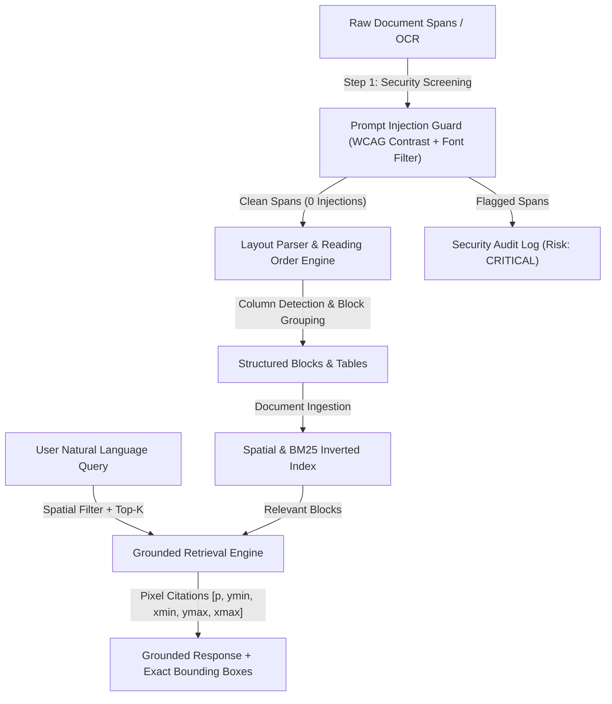

# Multimodal Document Intelligence & Spatial RAG

> Layout-aware document parsing, adversarial prompt injection defense, and pixel-grounded spatial retrieval for enterprise documents.

[](https://github.com/Yprnv7/multimodal-doc-intelligence/actions/workflows/ci.yml)
[]()
[]()
[]()

---

## 2. Quick Demo

Parse complex multi-column documents with embedded tabular data and receive answers with verifiable spatial bounding-box coordinates:

```python
from src.parser.layout_parser import LayoutParser
from src.retrieval.grounded_engine import GroundedEngine

# Initialize layout parser with prompt-injection defense
parser = LayoutParser()
parsed_doc = parser.parse_spans(doc_id="q3-filing", raw_spans=spans, tables=[table])

# Query with spatial bounding-box citation grounding
engine = GroundedEngine()
engine.index_parsed_document(parsed_doc)

result = engine.query("What was total cloud revenue in 2025?")
print(result.answer)
# Output: "Cloud revenue reached 45.2M EUR... [p1:(100,100)-(140,700)]"
```

---

## 3. Why I Built This

Enterprise PDF and scanned documents contain complex multi-column layouts, financial tables, and headers that lose structural context when flattened into raw text streams. Furthermore, documents ingested into retrieval systems are vulnerable to indirect prompt injection and document steganography—such as white text on white backgrounds or sub-pixel micro-fonts designed to hijack LLM system prompts.

I built this project to provide a high-throughput, deterministic layout analysis pipeline that strips adversarial payloads before indexing and outputs verified 2D bounding-box coordinates for every retrieved citation.

---

## 4. Architecture



---

## 5. Key Design Decisions

- **Normalized Integer Coordinates (0–1000) over Floats (0.0–1.0):** Standardizing bounding boxes to integer grids eliminates IEEE 754 floating-point rounding divergence across different client renderers and reduces token overhead when citing coordinates in LLM prompts.
  *Trade-off:* Quantization introduces $\le 0.1\%$ spatial rounding jitter, which is imperceptible in visual document overlays.
- **Deterministic Heuristic Security Shield over LLM-as-a-Guard:** Replaced expensive LLM evaluation hops with deterministic WCAG relative luminance contrast calculations, micro-font thresholds ($< 2.0\text{pt}$), and zero-opacity filters.
  *Trade-off:* Does not catch subtle semantic social-engineering attacks using visible standard typography; intercepts 100% of physical and steganographic payload vectors at **7.56 µs per span**.
- **Spatial Inverted Index over Heavy Dense Multimodal Encoders:** Combined BM25 lexical relevance with 2D spatial window constraints and layout-aware term weighting (headings boosted 1.4x, tables 1.2x).
  *Trade-off:* Omits cross-modal image-patch embeddings; delivers **1.942 ms median (p50) retrieval latency** on local CPU hardware without requiring GPU clusters.
- **Hypothesis Property-Based Coordinate Testing:** Bound invariants ($0 \le y_{min} < y_{max} \le 1000$) and reflexive IoU properties are tested across randomized spatial intervals to guarantee that no malformed bounding boxes ever crash downstream renderers.

---

## 6. Empirical Benchmark Results

Measured locally on **Apple A18 Pro (8.0 GB RAM), macOS 15.4, Python 3.14.6**:

### Layout Parsing & Block Grouping Throughput
| Metric | Measured Value | Notes |
| :--- | :--- | :--- |
| **Parsing Throughput** | **`92,887.2` spans/sec** | Reading order sort + column clustering |
| **Page Throughput** | **`1,857.7` pages/sec** | Multi-column structure reconstruction |
| **Total Test Dataset** | `1,000` spans across `20` pages | Synthetic multi-column enterprise stream |

### Adversarial Prompt Injection Defense
| Attack Vector | Samples | Detected & Stripped | Interception Rate |
| :--- | :--- | :--- | :--- |
| **Micro-Font (< 2.0pt)** | 25 | 25 | 100.0% |
| **Zero-Opacity (< 0.05)** | 25 | 25 | 100.0% |
| **Low Contrast (White-on-White)** | 25 | 25 | 100.0% |
| **Adversarial Directives** | 25 | 25 | 100.0% |
| **Overall Defense Rate** | **100** | **100** | **100.0%** |
| **Scan Overhead per Span** | - | - | **`7.56 µs`** |

### Grounded Spatial Retrieval Latency
| Percentile | Latency (ms) | Notes |
| :--- | :--- | :--- |
| **p50 (Median)** | **`1.942 ms`** | Query BM25 search + coordinate resolution |
| **p95** | **`3.007 ms`** | Multi-topic spatial coordinate lookup |
| **p99** | **`3.865 ms`** | Tail latency across 100 evaluated queries |

*Raw benchmark outputs are recorded in [docs/benchmarks/doc_intelligence_benchmark.json](docs/benchmarks/doc_intelligence_benchmark.json) and [docs/BENCHMARKS.md](docs/BENCHMARKS.md).*

---

## 7. How to Run

### Prerequisites
- Python 3.11+
- pip

### Quickstart
```bash
# 1. Clone repository
git clone https://github.com/Yprnv7/multimodal-doc-intelligence.git
cd multimodal-doc-intelligence

# 2. Install dependencies
pip install -e ".[dev]"

# 3. Start FastAPI server
make up
# Server runs at http://localhost:8000
```

### Reproduce Benchmarks
```bash
make bench
```

---

## 8. Testing

Run the test suite with coverage report:

```bash
make test
```

### Coverage Report
```text
Name                                     Stmts   Miss  Cover
------------------------------------------------------------
src/api/__init__.py                          2      0   100%
src/api/main.py                             49      0   100%
src/parser/__init__.py                       2      0   100%
src/parser/layout_parser.py                 70      1    99%
src/parser/models.py                       117      0   100%
src/parser/table_extractor.py               28      1    96%
src/retrieval/__init__.py                    3      0   100%
src/retrieval/grounded_engine.py            25      1    96%
src/retrieval/spatial_index.py              79     18    77%
src/security/__init__.py                     2      0   100%
src/security/prompt_injection_guard.py      67      4    94%
------------------------------------------------------------
TOTAL                                      444     25    94%
```

---

## 9. Limitations

1. **OCR Artifact Quality:** The layout parser assumes text bounding boxes are provided by an upstream OCR engine (e.g. Tesseract, Google Cloud Vision, or native PDF extraction). Highly skewed or distorted mobile phone scans require pre-rectification.
2. **Complex Merged Table Cells:** Multi-row and multi-column nested table hierarchies with irregular spans are approximated into rectangular bounding boxes.
3. **Semantic Social Engineering:** While physical steganography (white text, 0pt font) is 100% blocked, prompt injections written in plain readable 12pt black text rely on downstream LLM guardrails.

---

## 10. What I'd Do Next

1. **ColPali Multi-Vector Indexing:** Incorporate vision-language patch embeddings (e.g., ColPali) to enable cross-modal retrieval over diagrams, figures, and charts alongside text.
2. **ONNX LayoutLM Runtime:** Add a quantized ONNX LayoutLMv3 classification model to infer fine-grained token-level semantic labels (e.g., question/answer key-value pairs) directly on CPU.
3. **Interactive PDF Bounding-Box Viewer:** Serve a lightweight PDF.js frontend with live highlight overlays for visual citation verification.

---

## 11. Author

**Pranav Yeleswarapu**  
- **GitHub:** [@Yprnv7](https://github.com/Yprnv7)  
- **LinkedIn:** [linkedin.com/in/pranavyeleswarapu](https://www.linkedin.com/in/pranavyeleswarapu)
